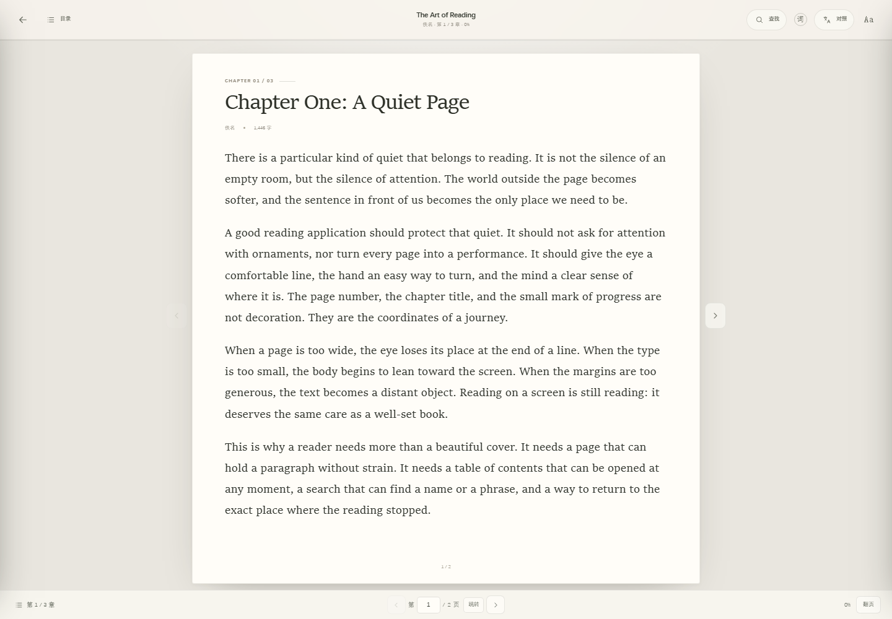
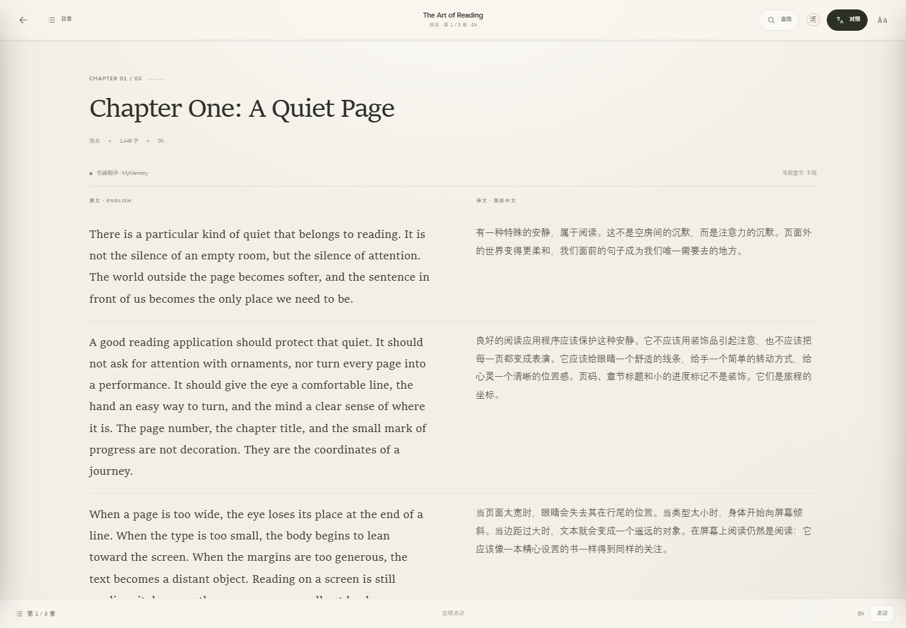

# 拾页 · 能读书的阅读档案

一本真正可以读书的本地阅读器，也是一份关于「读过的书」的阅读档案。

它可以导入 EPUB / TXT，用接近桌面文档阅读器的翻页界面读完整本；遇到还没有中文版的书，打开「对照」就能看原文和译文。书架、年度目标、阅读足迹、分类和成就，把每一次阅读留下来。



## 打开方式

最方便的是直接双击桌面上的 **拾页** 图标。

它会在后台启动本地阅读服务，并用 Chrome / Edge 的应用窗口模式打开书架，就像一个小型桌面应用。第一次启动需要几秒，之后会直接复用已经运行的本地服务。

如果桌面图标被删除，或者移动了项目文件夹，双击项目里的 **`create-desktop-shortcut.cmd`** 重新创建即可。

也可以双击 **`start.cmd`**，然后访问：

```
http://127.0.0.1:4173
```

> 也可以直接双击 `index.html`，但部分浏览器会限制本地文件的存储能力；查词接口也需要本地服务。为了完整使用，建议走桌面快捷方式。

需要 Node.js。桌面快捷方式启动的本地服务会安静地留在后台；关闭电脑或注销后会自动结束。

## 怎么读一本书

1. 打开「我的书架」，点击 **导入电子书**，选择 `.epub`、`.txt` 或 `.md` 文件。
2. 导入后会直接进入翻页阅读器。左右方向键、PageUp / PageDown、鼠标滚轮和页面两侧的箭头都可以翻页。
3. 底部状态栏可以输入页码并「跳转」；左上角「目录」可以跳到任意章节；「查找」可以搜索整本书，并带回原句位置。
4. 在阅读设置里可以切换「翻页 / 滚动」，调整字号和行距。翻页进度会自动保存。
5. 书里的注释编号、章节链接和回链都可以直接点击；跳到注释后，左下角会出现「返回原文」。
6. 点击顶部「对照」，当前章节会切换为原文 / 译文并排的滚动阅读。再点一次关闭对照，之后可以继续切回翻页。

> 注释跳转依赖导入时保留的链接信息。之前版本导入过的电子书需要**重新导入一次**原文件；旧版已经丢失了链接，无法补回。

## 主要功能

### 01 / 翻页阅读，不再是一直往下滚

- **翻页模式**：默认把当前章节排成连续书页，页与页之间有清楚的边界，支持翻页、回退和跨章连续阅读。
- **页码跳转**：底部状态栏显示本章页码，输入页码即可跳转；翻到本章末尾会自然进入下一章。
- **层级目录**：保留 EPUB 自带的卷、篇、章节父子关系，可以逐层展开 / 折叠；目录项会定位到对应章节或段落，桌面端目录会保持打开，方便连续跳转。
- **目录与查找**：左侧目录可以快速跳章；查找覆盖整本书，结果会显示章节和上下文，点击后回到原句附近。
- **注释与书内链接**：保留 EPUB 的脚注编号、章节内链和回链；点击注释编号会跳到对应的注释页或注释段落，并在左下角提供「返回原文」。
- **补齐注释页**：有些 EPUB 把注释放在没有列进 spine 的文档里；导入时会把这些被链接到的注释页一并收进来。
- **滚动模式**：保留连续滚动，适合快速浏览或双语长文；翻页与滚动可以随时切换。
- **阅读状态**：顶部显示书名、章节、总进度，底部显示页码、百分比和当前阅读方式。
- **舒适排版**：18px 默认字号、舒适行距、居中的纸页宽度；字号 14–24px，三档行距，偏好保存在本机。
- **读完一本书**：最后一页可以标记「已读完」，同步年度目标、成就和阅读档案。
- **阅读时间**：阅读器打开期间记录有效阅读时间，关闭后计入阅读足迹与今日阅读。

### 02 / 没有中文版，也能读下去

- **左右对照**：开启「对照」后，当前章节的原文和译文按段并排。因为双栏译文不适合分页，对照模式会自动切换到滚动阅读。
- **只翻当前章节**：不会一次性把整本书发给翻译服务。切换章节时会自动翻译新章节，并缓存已翻译的章节。
- **选中即查**：在原文里选中一个词，浮出「查词」；也可以点顶部「词」手动输入。
- **不只英文**：英文单词可查音标、发音、词性和英文释义；其他语言或词组会给出机器翻译和原句语境。
- **译读工作台**：除了书内对照，还保留「译读」页，适合临时粘贴一段没有电子书的原文做逐段对照。



### 03 / 把成就变成看得见的日常

- **年度阅读目标**：可随时调整目标本数，进度环和侧边栏会同步更新。
- **阅读数据**：今年已读、累计页数、阅读时长、点亮徽章数。
- **连续阅读**：当前连续天数、最长纪录、近 7 天状态。
- **阅读足迹**：过去 20 周的阅读热力图，记录每天的阅读节奏。
- **阅读成就**：阅读段位、8 枚可点亮徽章、年度月度阅读曲线。
- **完成一本书**：更新进度、标记读完时会有相应的庆祝反馈。

### 04 / 让书有自己的位置

- **分类书架**：文学小说、心理成长、商业思维、历史人文、设计美学、科学科技。
- **新建分类**：可以在「分类书架」里创建自己的分类，并选择颜色。
- **分类版图**：按藏书数量显示环形分布，并统计每个分类的已读 / 在读 / 想读。
- **书架筛选**：按阅读状态、分类、书名或作者搜索；支持最近阅读、阅读进度、最近加入、书名排序。

### 05 / 安静地留在本机

- 这一版不再内置示例书或演示数据。旧版本留下的示例书、示例统计和示例导入内容会在第一次刷新时清理，书架从真实内容开始。
- 阅读器和书架的元数据保存在 `localStorage`，导入的电子书正文和章节翻译缓存在 `IndexedDB`。
- 书不会上传到任何服务器；翻译时只把**当前章节**的原文发送给在线翻译服务。
- 设置中可以导出阅读数据的 JSON 备份，或清空全部阅读数据。
- 注意：JSON 导出不包含 EPUB/TXT 原文件；清空数据会同时清理本地导入的电子书正文与翻译缓存。

## 目前的范围

- 支持：EPUB（文字版）、TXT、Markdown。
- 暂不支持：PDF、MOBI、AZW3、带 DRM 的电子书。
- EPUB 目前只抽取文字与基础排版，不渲染原书图片和复杂样式；注释与书内链接会保留并支持跳转。
- 之前版本导入的电子书没有保留链接信息，需要重新导入原文件才能使用注释跳转。
- 页码按**当前章节**计算；更换字号或窗口大小后会重新分页。EPUB 没有纸质书那样的固定页码，所以这里用章节内页码配合总进度。
- 翻译由浏览器直接请求在线服务，查词通过本地 Node 服务代理 Free Dictionary API / Wiktionary。两者都需要联网。
- 在线接口没有配置商业 API Key，适合个人日常阅读；如果长期高频使用，建议替换成有配额的正式翻译 / 词典服务。

## 技术说明

- 纯 HTML / CSS / JavaScript，前端无构建步骤；EPUB 解包使用本地化的 JSZip。
- 电子书正文存在浏览器 `IndexedDB`，书籍元数据在 `localStorage`。
- 本地启动服务使用 Node.js 内置模块，无 npm 依赖。
- 文件结构：

```
shiye-reader/
├─ index.html              页面骨架
├─ styles.css              主界面样式
├─ reader.css              WPS 式阅读器、翻页与对照样式
├─ app.js                  阅读档案、书架、成就、译读工作台
├─ reader.js               EPUB/TXT 导入、分页阅读、搜索、对照与查词
├─ server.mjs              本地静态服务 + 翻译/查词代理
├─ start.cmd               Windows 命令行启动
├─ launch.ps1              桌面快捷方式使用的隐藏启动器
├─ create-desktop-shortcut.cmd  重新创建桌面快捷方式
├─ create-desktop-shortcut.ps1
├─ manifest.webmanifest    PWA / 应用窗口信息
├─ icons/                  应用图标、桌面图标
├─ package.json            启动脚本与项目信息
├─ vendor/
│  ├─ jszip.min.js         EPUB 解包
│  └─ JSZIP-LICENSE.md
├─ favicon.svg             站点图标
├─ preview-reader.png      翻页阅读预览图
├─ preview-reader-bilingual.png 对照阅读预览图
└─ README.md
```

## 下一步可以继续做

- 注释悬浮卡片、脚注预览和注释收藏
- EPUB 图片和更完整的原书排版
- 双页模式、书签、划线与阅读笔记
- PDF / MOBI 导入
- 生词本和阅读数据跨设备同步

---

**拾页** — 把读过的书，留在时光里。
